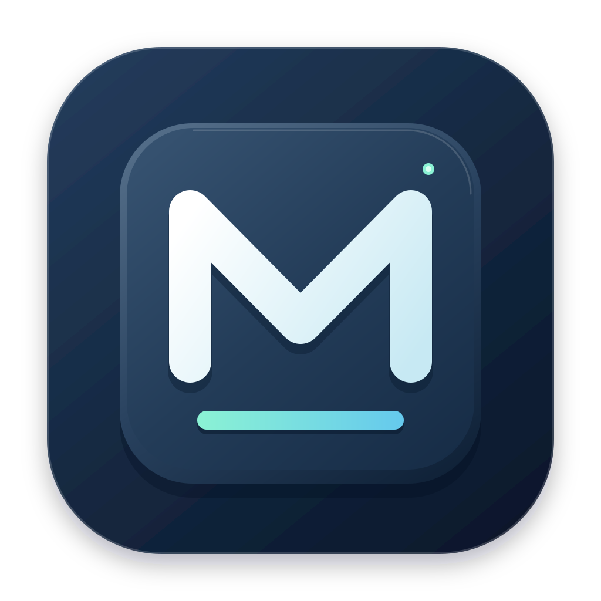

# MCHOSE HUB 原生客户端

2026-11-02。提供 Windows x64 客户端及 Swift 原生 macOS 开发版。



Windows 客户端使用原生 WinUI 3。仓库新增 [Swift 原生 macOS 版](macos/README.md)，接入已有键盘的灯光、性能、三层映射、宏、配置库、USB/2.4G 与音频 HID 功能；真实 K87 2.4G 已通过双次完整读取和亮度、休眠、单键的修改/恢复。代码与实机验收范围见 [macOS 验证记录](macos/VALIDATION.md)。继续开发时请先阅读 [macOS 移植说明](docs/MACOS_PORT.md)。

## macOS 使用

完整步骤见 [macOS 使用说明](macos/README.md)。需要 macOS 14 或更新版本；当前实测环境为 Apple Silicon / macOS 27.2，其他系统和架构尚待验证。

从 [macOS Actions 构建](https://github.com/wzk112/MchoseHub/actions/workflows/macos.yml)中选择成功的运行，下载对应架构的 artifact，解开其中的安装包 ZIP，再将 `MCHOSE HUB.app` 拖到“应用程序”。这是本地 ad-hoc 签名的开发包，尚未做 Developer ID 签名或公证；不要求安装 .NET。也可用 Xcode 提供的 Swift 6 从源码构建：

```sh
git clone https://github.com/wzk112/MchoseHub.git
cd MchoseHub/macos
swift test -Xswiftc -warnings-as-errors
bash build-app.sh ../artifacts/macos
```

首次读取真实设备前，在“系统设置 → 隐私与安全性 → 输入监控”中允许已安装的 MCHOSE HUB，然后退出重开。未授权时仍可使用独立预览、本地配置和宏编辑。左侧选择 USB 或 2.4G 接口，读取完整配置后编辑草稿，点击“应用当前草稿到设备”才会写入；恢复前会另存备份。宏库不包含在配置备份内。

图标的可编辑源文件为 [AppIcon.svg](macos/Assets/AppIcon.svg)，打包脚本使用同源生成的 `.icns`。

## Windows R2 更新

- 左侧功能导航、中央键盘图、右侧灯效参数，设备状态集中显示。
- 使用清晰的功能名称和操作说明，提供浅色和深色主题。
- 在键盘图上选键，查看和修改默认、Fn、Fn2 三层映射；切换层时清除旧选择。
- 可视化宏选择、名称与触发方式设置、事件添加/移除、延时调整；录制结果追加到宏库。JSON 保留为高级入口。
- 录制框捕获按下与释放事件，支持 Backspace；离开录制框时补齐仍按住按键的释放事件。
- 修改宏名称和触发方式后，点击“更新宏信息”保存到草稿；上传按钮随草稿有效性更新。停止录制后保留已有宏并加入录制结果。
- 窄窗口将灯效参数移到键盘下方；标题栏图标随深色、浅色主题调整。
- 命名本地配置库，JSON 导入/导出，按型号校验。载入不写设备，应用时确认。
- K87 离线体验可试用改键、灯光、宏及配置库，不访问物理设备；预览配置库独立存储。
- 修复实机发现的改键保留字段覆盖问题，完整保留原始键表的非零保留槽。
- 完整配置恢复后重新读取并核对全部已解析配置字段；不一致时指出位置并停止，不自动再次恢复。
- 读取或写入失败后，后续编辑会重新读取当前设备配置，避免旧数据覆盖已经生效的设置。

## Windows 使用

双击运行包中的 MchoseHub.exe。保留整个目录，不能只复制 exe。绿色包自带 .NET 8 和 Windows App SDK。

设备中心选择键盘后进入设备。灯光自动保存；性能与改键使用应用按钮。不要同时用多个配置程序控制同一键盘。

宏：选择或新建宏，编辑事件或在录制区内录制，再保存到本机。名称或触发方式有修改时，先点击“更新宏信息”。上传完整宏库会覆盖键盘现有宏库；上传后在按键页选择目标键，再到宏页绑定。修改宏草稿后需重新上传再绑定。

配置：读取当前配置或导入文件，填写名称后保存到本地库。选中方案载入，再点击应用已载入配置。保存优先使用当前载入/导入内容；没有草稿时读取设备。只接受同型号配置。备份包含性能、灯光、逐键色和三层按键，不包含宏库，宏应另存。

## Windows 验证

64 项离线检查通过，覆盖配置校验、恢复、故障后的状态处理、宏录制边界和无线协议模拟。

窗口操作已验证：离线预览中将 A 改为 F1、切换 Fn 层后清除选择、显示宏目录结果、保存和载入命名配置。录制框输入 a 和 Backspace 得到完整的四个按下/释放事件；停止录制成功，上传按钮启用，原示例宏保留。修改名称后上传禁用，恢复原名后重新启用。

前一轮 K87 有线实机已完成亮度、休眠、Default 层单键映射的写入、回读和恢复。初测发现保留槽覆盖问题，精确恢复并修复后重测通过。最终比较 51 个标量、44 个字节数组、306 个键表槽位，无差异。测试间隔观察到 Mac 模式变化，重测另存当前基线并保留该变化。

R2 已在真实 K87 有线连接中验证界面重连与读取：常亮模式 1、亮度 100%。本轮没有向物理设备写入配置。

最小宽度 960 DIP 的窗口约束已验证，窄窗口布局完整，灯效参数移到键盘下方。最大化与还原正常；深色标题栏使用白色图标，跟随系统浅色时使用黑色图标，两种状态均已验收。

最终 Release 发布通过，启用 .NET 分析器并将警告视为错误。高对比度 SVG 仅完成静态检查与构建验证，未切换系统高对比度设置实测。

实机宏库尚未测试；2.4G 本轮仅完成离线协议测试。配置回读不等于实际灯光观感或操作系统按键事件测试。

## 官网与范围

本次重新核对[官方网页驱动](https://www.mchose.com.cn/)的最新资源。协议数据保持 2026-10-05 已审查快照，未直接套用新磁轴设备的协议或未知板载槽。

已有常规灯效、逐键 RGB、回报率、休眠、低延迟、Win 锁定、Mac 模式、三层改键、166 项官方功能码、宏上传/绑定、配置备份恢复、电量及诊断。

音乐/GIF、云模板、固件升级、多设备灯光同步、程序关联切换尚未原生实现。本地配置库不代表 K87 有多个板载槽。宏上传只能验证首个目录项，完整事件仍需实机验证；有线上限 65535 字节，无线上限 3570 字节。

## Windows 构建

```powershell
dotnet build MchoseHub.sln -c Release -p:Platform="Any CPU" -p:EnableNETAnalyzers=true -p:TreatWarningsAsErrors=true
dotnet run --project tests/MchoseHub.Tests -c Release
./build.ps1 -Portable
```

只读枚举：dotnet run --project src/MchoseHub.Cli -c Release -- --groups
